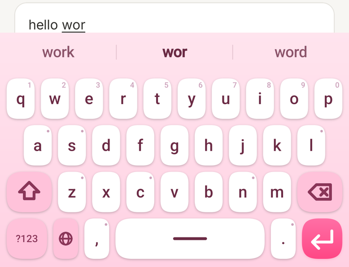
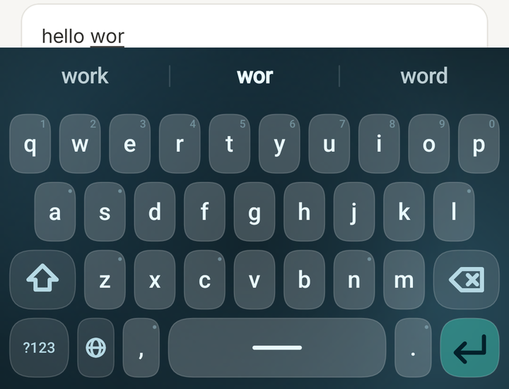
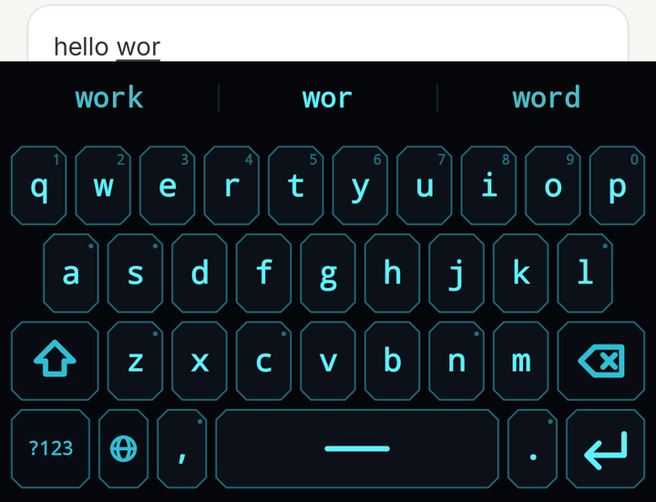
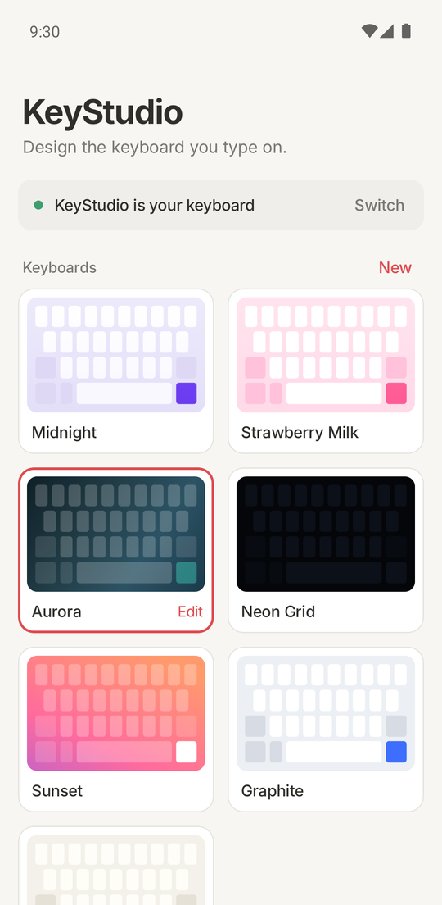
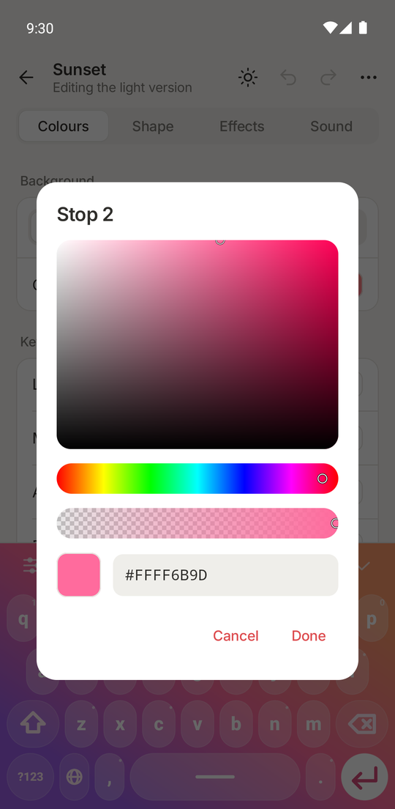
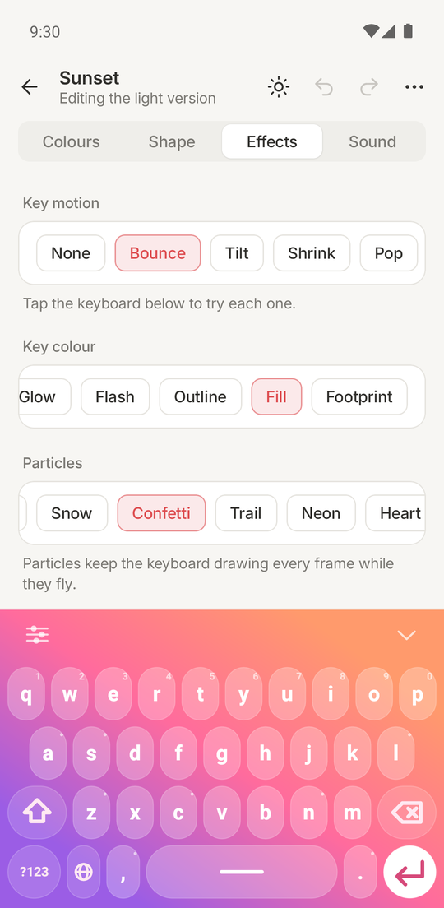
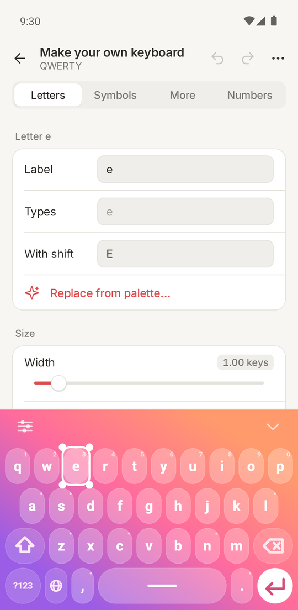

# KeyStudio

A customisable Android keyboard for the Poco X3, built in the spirit of Samsung's
Keys Cafe: design the keyboard you want -- colours, key shapes, press effects,
animated backgrounds, the key layout itself -- and then type on it.

Keys Cafe is a Samsung-only Good Lock module that customises the *Samsung*
Keyboard. KeyStudio is both halves in one app: the keyboard, and the studio that
designs it.

<p align="center">
  
  
  
</p>
<p align="center"><em>Three of the presets — Strawberry Milk, Aurora, Neon Grid — with suggestions while typing.</em></p>

<p align="center">
  
  
  
  
</p>
<p align="center"><em>The Studio: your designs, a colour picker, press effects, and the layout editor — each over the real keyboard, live.</em></p>

**Resuming work?** Read [`docs/STATE.md`](docs/STATE.md) first — it holds the
aim, what is done, the environment gotchas, the decisions already settled, and
exactly what to pick up next. For anything visual, [`docs/DESIGN.md`](docs/DESIGN.md) is the
design guide the Studio is built to.

## Status

Working today:

- A real system IME that types, with shift/caps, auto-capitalisation,
  double-space-to-period, long-press accents, key repeat, symbol layers and a
  globe key to switch back to another keyboard.
- A data-driven rendering engine: key shapes (rounded / squircle / pill / circle
  / cut / flat), solid and gradient fills, per-key style overrides, strokes,
  shadows, vector key icons, hint glyphs.
- Spring-driven key motion, key colour effects, and a particle system.
- Animated backgrounds rendered at 1/8 resolution and upscaled -- the upscale is
  the blur, which is what keeps a live gradient cheap on an Adreno 618.
- Seven preset themes, and a Studio app whose live preview is the real keyboard
  view, not a mock-up.
- A theme editor with the four tabs Keys Cafe has -- Colours, Shape, Effects,
  Sound -- over a pinned copy of the real keyboard: HSV colour picker on every
  slot, solid or gradient, key shape and size, fonts including your own font
  files, animated and photo backgrounds, light and dark variants, undo/redo, and
  export or import of a design as a single JSON file.
- No Save button: a change is on the keyboard before you lift your finger, in
  the Studio and in every other app at once, the way Keys Cafe does.
- The keyboard runs in its own process, so the Studio cannot take it down.
- Typing that keeps up: two-finger rollover, swipe typing, word suggestions,
  conservative autocorrect with backspace-to-undo, learned words, space-bar
  cursor, backspace word-swipe.
- A layout editor ("Make your own keyboard"): select any key, change what it
  types, resize it, fill its long press from palettes, move, add, duplicate or
  delete keys, macro keys, a pinned top row.
- A Studio styled after Bear and Notion, in light and dark.

Verified running on the target hardware (Poco X3 NFC, Android 12).

See `docs/ROADMAP.md` for what is next.

## Building and running

Everything goes through one script, so the toolchain lives in exactly one place.
It is written for Windows and reads this machine's paths from `local.properties`
(git-ignored):

```
sdk.dir=C:/path/to/Android_SDK
kb.java.home=C:/path/to/jdk-21
kb.wifi.host=192.168.1.20:37000      # optional, for `kb.py connect`
```

On any platform, `./gradlew :app:assembleDebug` with JDK 21 builds the APK.

```
python tools/kb.py doctor         # check JDK / SDK / emulator / wrapper
python tools/kb.py build          # assemble the debug APK
python tools/kb.py install        # build + install on the connected device
python tools/kb.py avd-create     # make a clean API 31 AVD for this project
python tools/kb.py emu            # boot it
python tools/kb.py ime-on         # enable + select KeyStudio as the keyboard
python tools/kb.py ime-off        # put your previous keyboard back
python tools/kb.py shot out.png   # screenshot the device
python tools/kb.py logcat         # tail the log
```

Targets Android 8.0+ (minSdk 26); developed against API 31 to match the Poco X3.

## Layout

```
core/    model, layout engine, renderer, effects, persistence, KeyboardView
app/     the IME service and the Compose Studio UI
tools/   the dev harness
docs/    architecture and roadmap
```

## Third-party material

- English word list: AOSP LatinIME, Apache-2.0 (`core/src/main/assets/dict/NOTICE`).
- Inter typeface: SIL Open Font License 1.1 (`app/src/main/assets/licenses/Inter-OFL.txt`).
- Icon paths: Lucide, ISC licence (`app/src/main/assets/licenses/Lucide-ISC.txt`).

KeyStudio is an independent project, not affiliated with or endorsed by
Samsung. Keys Cafe and Good Lock are Samsung's.

## Licence

Apache License 2.0 — see [`LICENSE`](LICENSE).
